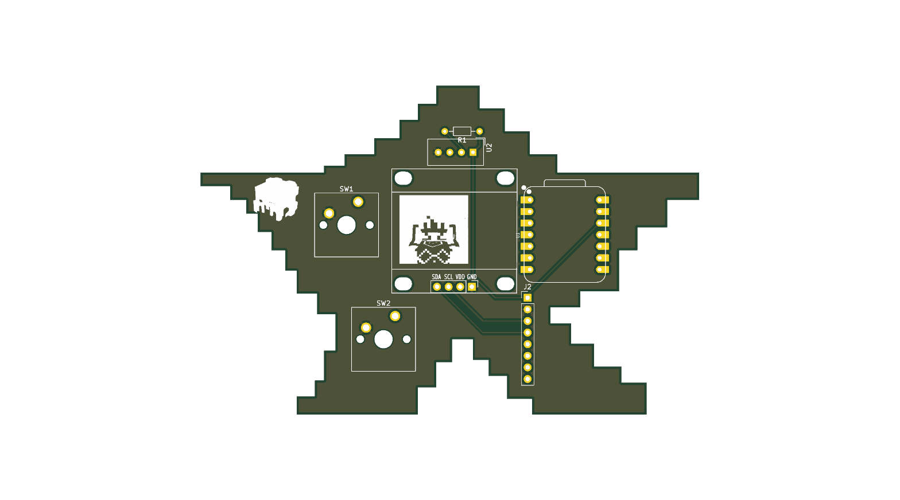
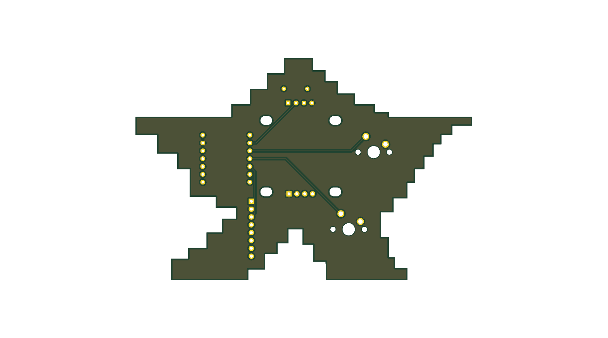

# Starbie

A tiny motion-controlled digital pet, basically a desktop Tamagotchi. Totally not a Starboy.



## Overview

Starbie is an interactive desktop companion powered by the **Seeed Studio XIAO ESP32-C3**. It features an OLED display for animated expressions and reactions, mechanical key switches for interaction, an MPU6050 6-axis IMU for motion and tilt sensing, and a DHT11 sensor for environmental temperature/humidity monitoring.

### 3D Render

| Front | Back |
| :---: | :---: |
|  |  |

---

## Hardware Specifications

- **Microcontroller:** Seeed Studio XIAO ESP32-C3
- **Display:** 0.96" 128x64 I2C OLED (SSD1306)
- **Motion Sensor:** MPU6050 6-DoF Accelerometer & Gyroscope
- **Environment Sensor:** DHT11 Temperature & Humidity Sensor
- **Inputs:** 2x Cherry MX PCB-mount mechanical switches
- **Connectivity / Power:** USB-C (via XIAO board) / 3.3V & 5V logic

---

## Repository Structure

```text
├── firmware/
│   └── starbie/
│       └── Starbie.ino         # Arduino sketch for Starbie pet firmware
├── hardware/
│   ├── half_life_week_one.kicad_pcb   # KiCad PCB layout
│   ├── half_life_week_one.kicad_sch   # KiCad schematic
│   ├── half_life_week_one.kicad_pro   # KiCad project file
│   ├── bom.csv                        # Bill of Materials
│   ├── gerbers.zip                    # Production Gerber and drill files (zipped)
│   ├── gerbers/                       # Raw Gerber plot outputs
│   └── Imported Parts.pretty/         # Custom footprint libraries
├── images/
│   ├── pcb_front.png           # 3D render of PCB (Front)
│   └── pcb_back.png            # 3D render of PCB (Back)
├── bom.csv                     # Bill of Materials (root copy for bots)
├── BOM.md                      # Half-Life synced parts list
├── JOURNAL.md                  # Development log
└── README.md                   # Project overview & documentation
```

---

## Bill of Materials

| Reference | Component | Footprint | Quantity |
| --- | --- | --- | --- |
| **U1** | XIAO ESP32-C3 | Seeed XIAO SMD/DIP | 1 |
| **J1** | 0.96" I2C OLED (128x64) | 1x04 2.54mm Header | 1 |
| **J2** | MPU-6050 IMU Module | 1x08 2.54mm Header | 1 |
| **U2** | DHT11 Sensor | DHT11 4-Pin | 1 |
| **SW1, SW2** | Cherry MX Switches | Cherry MX 1.00u PCB | 2 |
| **R1** | 10kΩ Resistor | Axial DIN0204 Horizontal | 1 |
